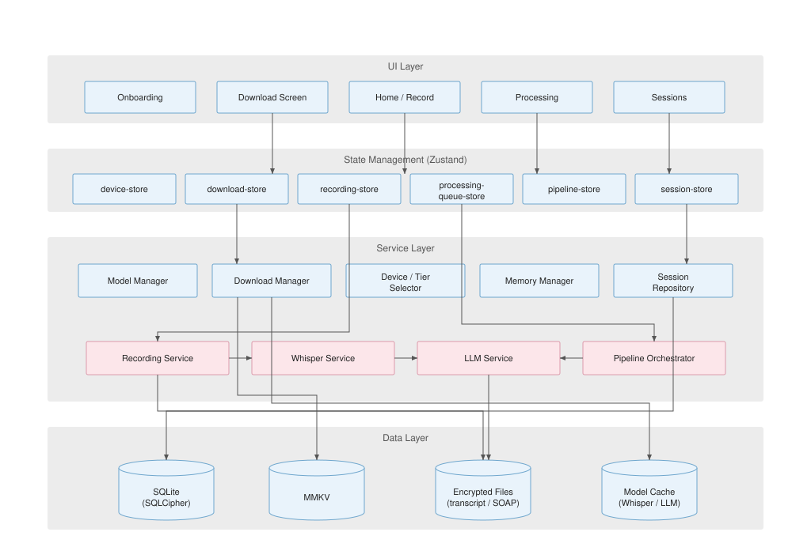

<h1 align="center">CaseScriptAI</h1>
<p align="center">
  <strong>
    Cloud-backed clinical sessions for iOS and Android — capture, transcribe, structured notes, PDF
  </strong>
</p>
<p align="center">
  
  
  
</p>

Therapist↔patient live sessions with server-side recording, free-tier STT/LLM adapters, and PDF notes. Production targets are **iOS and Android** (web is UI/dev only unless a cloud slice says otherwise).

An older **on-device** (ExecuTorch Whisper/LLM) path remains in the repo as archive — see track picker below.

## Start here (pick a track)

| Track | When to use | Start at |
|-------|-------------|----------|
| **Cloud MVP** (current) | Product architecture, slices, day-to-day feature work | [`docs/ARCHITECTURE_CLOUD.md`](docs/ARCHITECTURE_CLOUD.md) §0 → [`AGENTS_CLOUD.md`](AGENTS_CLOUD.md) |
| **Hacktoberfest weekend demo** | Contest branch `hacktoberfest/render-session-note`, demo API + Google login | [`docs/HACKTOBERFEST_WEEKEND_SCOPE.md`](docs/HACKTOBERFEST_WEEKEND_SCOPE.md) → [`apps/hacktoberfest-api/README.md`](apps/hacktoberfest-api/README.md) |
| **On-device / historical** | Offline ExecuTorch work only (`mvp_local_AI`) | [`docs/ARCHITECTURE.md`](docs/ARCHITECTURE.md) → [`AGENTS.md`](AGENTS.md) |

Dev practices (TDD, layers, security habits): [`PROJECT_RULES.md`](PROJECT_RULES.md). Before auth/storage/crypto/network/logging: [`docs/OWASP_MOBILE_TOP_10.md`](docs/OWASP_MOBILE_TOP_10.md).

## Repo layout

```
apps/CaseScriptAI/        Mobile app (Expo / React Native)
apps/hacktoberfest-api/   Weekend demo API + Postgres
docs/                     Architecture, slices, OWASP
packages/                 Shared workspace packages
```

## Prerequisites

- **Node** — version in [`.nvmrc`](.nvmrc) (currently 20)
- **Yarn 4** — `packageManager` in root `package.json`; use `yarn` from the repo root (never npm/pnpm at root)
- **Xcode** (iOS) / **Android Studio** (Android)
- **Dev client**, not Expo Go — native modules and Clerk Google SSO need `expo run:ios` / `expo run:android`

## Quick start (mobile)

From the **repository root**:

```bash
yarn install
yarn workspace casescriptai ios       # requires Xcode; use --device for a physical phone
yarn workspace casescriptai android   # requires Android Studio
yarn workspace casescriptai web       # UI layout only — no AI/native modules
yarn workspace casescriptai lint
yarn workspace casescriptai test
```

## Quick start (Hacktoberfest API)

Monorepo install is above. Full Docker / migrate / env steps:

→ [`apps/hacktoberfest-api/README.md`](apps/hacktoberfest-api/README.md)

```bash
# after yarn install + API .env
docker compose up -d
yarn hacktoberfest:migrate
yarn hacktoberfest:dev    # http://localhost:3001/
```

## Env cheat sheet

Never commit secrets. Copy from `.env.example` files where present.

| Variable | File | Notes |
|----------|------|--------|
| `EXPO_PUBLIC_CLERK_PUBLISHABLE_KEY` | `apps/CaseScriptAI/.env` | Client OK (`pk_…`) |
| `EXPO_PUBLIC_DEMO_API_URL` | `apps/CaseScriptAI/.env` | Local API base (simulator / emulator / device) |
| `CLERK_SECRET_KEY` | `apps/hacktoberfest-api/.env` | **Server only** (`sk_…`) — never in the mobile app |
| `DATABASE_URL`, provider keys | `apps/hacktoberfest-api/.env` | See API README |

Keys: [Clerk Dashboard → API keys](https://dashboard.clerk.com/). Or `cd apps/CaseScriptAI && clerk env pull` (then move secret into the API `.env` only).

## Auth (Google / Clerk)

Therapist Google sign-in uses **Clerk JS SSO** (`useSSO` + browser account picker). Native `@clerk/expo` autolinking is excluded so older Xcode (Swift tools below 6.2) can still build.

- **App-only smoke:** publishable key in mobile `.env` is enough to open Google and get a Clerk session.
- **DB upsert / roles:** run the API with `CLERK_SECRET_KEY` and follow the H5A checklist in [`apps/hacktoberfest-api/README.md`](apps/hacktoberfest-api/README.md).

## Architecture diagram (on-device archive)

Cloud MVP diagrams and invariants live in [`docs/ARCHITECTURE_CLOUD.md`](docs/ARCHITECTURE_CLOUD.md). The historical on-device HLD:


